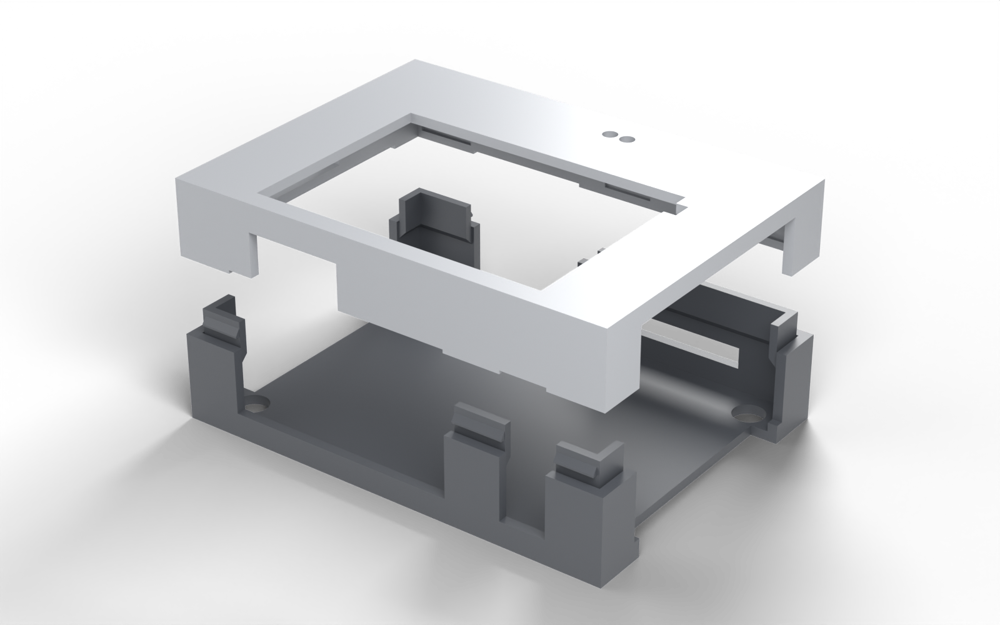

# EchoPilot AI 3D-Printable Enclosure



Two-part snap-fit case for the [EchoMAV EchoPilot AI](https://echomav.github.io/docs/latest/) +
Carrier stack with a Jetson Orin NX module. The geometry is generated from connector positions
in EchoMAV's `ECHOPILOT_FULL_STACK.step` and written as [KCL](https://zoo.dev/docs/kcl)
for Zoo Design Studio. Current version: **v7**, printed and test-fitted.

## Files
- `print/`: ready-to-print parts: `echopilot_case_v7_bottom.{stl,step}` and
  `echopilot_case_v6_top.{stl,step}` (the printed pair). The top shell is flipped, lid down.
- `cad/v7/`: v7 KCL. `main.kcl` is the assembly (top shell exploded 15 mm; `explode = 0`
  to close); `print_bottom/` and `print_top/` are print-oriented parts. Open in Zoo Design Studio.
- `tools/gen_kcl_v7.py`: regenerates `cad/v7/`. Parameters are at the top.
  Earlier generators (`gen_kcl.py` = v4, `_v5`, `_v6`) and their output in `cad/` are kept for reference.
- `tools/bbox.py`: dumps per-part bounding boxes from a STEP assembly to JSON (cadquery-ocp).
  The generator reads `ref/stack_bb.json`.
- `tools/plate.py`: slices both halves with the OrcaSlicer CLI using Bambu A1 presets fetched
  through an OrcaSlicer MCP server (`tools/mcp_call.py`). Optional; paths are local to my setup.

`ref/` is not in the repo. Download `ECHOPILOT_FULL_STACK.step` from
echomav.github.io/docs/latest/assets/ into `ref/`, then:

```sh
uv venv && uv pip install cadquery-ocp
.venv/bin/python tools/bbox.py ref/ECHOPILOT_FULL_STACK.step ref/stack_bb.json
.venv/bin/python tools/gen_kcl_v7.py
```

The v7 top shell's grooves changed after the last top export. Export `cad/v7/print_top`
from Zoo Design Studio for the newest top; the v6 top fits the v7 bottom.

## Assembly
1. Drop the stack into the bottom shell. It stands on its own corner standoffs, which pass
   through 4 Ø6.5 mm holes in the floor (at x ±38, y ±26), so the case and standoffs sit flush
   on the table.
2. Press the top shell on until the 7 bumps on the bottom shell's lip snap into its grooves.
   The lid bears on the SO-DIMM connector, which holds the stack down.

## Key numbers (STEP frame, origin = board centre)
- Outer 92 x 68 x 33.5 mm (z 11.5 to 45); 2 mm walls; 0.6 mm board-to-lip clearance.
- Parting line z = 29.3, between the carrier's top-side connectors (≤ 28.4) and the AI board's
  underside connectors (≥ 30.26).
- Snap lip 1.6 mm thick, 5 mm tall, 0.3 mm fit; bumps 0.6 mm interference; grooves are the catch
  profile + 0.1 mm.
- Lid underside at z 43.0, 0.13 mm below the SO-DIMM connector top: slight preload, no rattle.
- Heatsink window 60.8 x 43 mm over the Orin NX, with a fan-cable notch on its +x edge.
- 8 port openings covering all edge connectors (JST-GH, PicoBlade, XT30, USB, microSD, SIM,
  FFC, SM06B). Margins 2 mm on the ±x ends, 0.6–1.0 mm on the long ±y sides; openings merge
  when the pillar between them would be under 3 mm (±x) or 1.2 mm (±y).
- 2 Ø3 mm holes in the lid for the B3U buttons.

## Version history
| Version | Change |
|---|---|
| v1–v3 | Generated shells, merged port openings, standoff holes. |
| v4 | Etched port labels. |
| v5 | Labels removed. Snap lip moved outside the board outline; case floor flush with the standoff feet. |
| v6 | Lid preloads the SO-DIMM connector (was 1.4 mm clearance); snap interference 0.3 → 0.6 mm; wider ±x port margins for plug access; fan-cable notch. |
| v7 | Taller lip (3 → 5 mm) so the catch sits 2 mm above the split; grooves shaped to the catch profile; tighter fitted openings on the long sides, with low slots leaving the lip intact. |

## License
MIT for the generator code and case design. The EchoPilot STEP and drawings belong to EchoMAV
and are not included.
